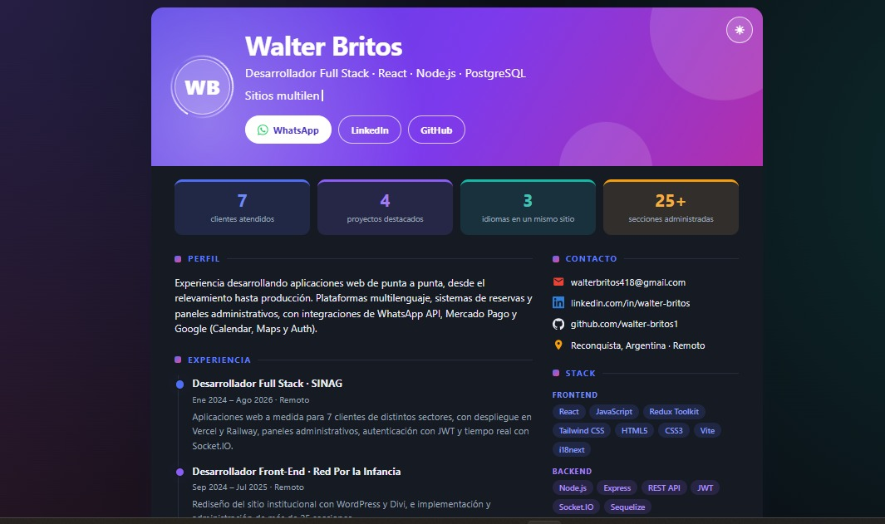

# CV digital · Walter Britos

CV digital de Walter Britos, desarrollador Full Stack (React, Node.js, PostgreSQL). Es una sola página, hecha con HTML, CSS y JavaScript puro, que reúne mi perfil, experiencia, proyectos y stack en un formato visual y rápido de leer.

**Ver en vivo:** [LINK](https://cv-digital-kappa.vercel.app/)

## 📸 Vista previa

<!-- Reemplazá la ruta por la imagen de captura de tu proyecto -->


## ✨ Qué incluye

- **Presentación personal:** con botones de contacto directo a WhatsApp, LinkedIn y GitHub.
- **Números destacados:** experiencia en línea de tiempo y proyectos con las tecnologías utilizadas.
- **Stack tecnológico:** agrupado por categoría (frontend, backend, bases de datos, integraciones y herramientas).
- **Modo claro y oscuro:** se adapta inicialmente a la preferencia del dispositivo y recuerda la elección de la persona.
- **Diseño responsive:** adaptado a celulares, tablets y computadoras.
- **Animaciones suaves:** se desactivan automáticamente si el dispositivo tiene activada la opción de reducir movimiento.
- **Vista previa al compartir:** etiquetas Open Graph para que el enlace se muestre correctamente en redes sociales y otras plataformas.

## 🛠️ Tecnologías

- HTML5
- CSS3 (variables, Grid, Flexbox, animaciones y modo oscuro).
- JavaScript (sin librerías ni frameworks).
- Íconos SVG incluidos en el propio HTML.

## 📁 Estructura del proyecto

```text
cv-digital/
├── index.html        # Estructura y contenido
├── css/
│   └── styles.css    # Estilos, temas y animaciones
├── js/
│   └── main.js      # Animaciones, contadores y botón de tema
└── assets/           # Imágenes y archivos (foto, captura y CV en PDF)
```

## 🚀 Cómo verlo en tu computadora

No necesita instalación ni compilación. Descargá o cloná el repositorio y abrí `index.html` en tu navegador.

### Clonar el repositorio

```bash
git clone https://github.com/Walter-Britos1/cv-digital.git
cd cv-digital
```

Después, abrí el archivo `index.html` en tu navegador.

### Usar un servidor local (opcional)

Si preferís visualizarlo mediante un servidor local, ejecutá:

```bash
npx serve .
```

## 📬 Contacto

- **LinkedIn:** [linkedin.com/in/walterbritos](https://linkedin.com/in/walterbritos)
- **GitHub:** [github.com/walter-britos1](https://github.com/walter-britos1)
- **Email:** [walterbritos418@gmail.com](mailto:walterbritos418@gmail.com)
